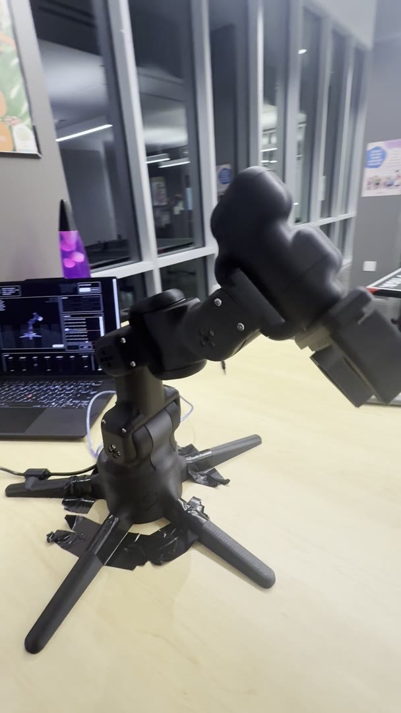
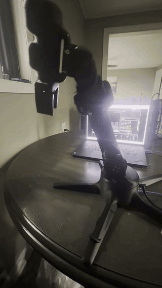

# 180° - 6-DOF robot arm with camera calibration

A 6-DOF servo arm with a gripper, built from FABRI Creator's [Brazo Robótico 5.0](https://fabricreator.com/products/kit-brazo-robotico-5-0-fabri-creator) and driven by an Arduino Uno. This repository holds the control side: a browser controller called **180°**, the Arduino sketch that drives the eight servos over serial, and a camera calibration script. The script uses OpenCV to find a coloured marker on the gripper while the arm steps through joint angles, fits a least-squares model from joint angles to camera pixels, and then lets you click a point in the camera view so the arm moves there.

Built by Gio ([Built-By-Gio](https://github.com/Built-By-Gio)).

*My arm moving through different poses on a table.* [Watch the full 25-second clip](video/arm_demo.mp4)

## Status (2026-11-25)

**Built and working**
- The arm is printed, assembled and wired to an Arduino Uno, with all joints moving. Photos of the arm and of the 180° controller page are in `photos/`. A 25-second clip of the arm moving is in `video/`.
- The 180° browser controller (`controller/index.html`) drives the real arm over USB from Chrome.
- Camera calibration and click-to-move worked on the real arm on 2026-10-20.

**Rewritten in November 2026**
- The original Arduino sketch and the original calibration script are on another computer. `firmware/arm_serial/arm_serial.ino` and `training/train.py` in this repository were rewritten to match the controller's serial protocol and channel map, and they run on the real arm.

**Not in this repository yet**
- The printable arm files (STL). They are sold by FABRI Creator and are not on this computer, so they are not included here.

**Still to add**
- Servo models, power supply rating and print settings.

## What you need

- The printed arm from FABRI Creator's [Brazo Robótico 5.0](https://fabricreator.com/products/kit-brazo-robotico-5-0-fabri-creator) (buy the files from FABRI Creator).
- 8 hobby servos on 7 joints (the shoulder uses two servos, mirrored).
- Arduino Uno and a USB cable.
- A separate 5-6 V supply for the servos. Do not power them from the Uno's 5 V pin; tie the grounds together.
- A webcam and a pink marker (tape) on the gripper, for calibration.
- Arduino IDE (the Servo library ships with it).
- Chrome or Edge on a desktop for the 180° controller (it uses Web Serial). The page loads three.js and anime.js from a CDN, so it needs an internet connection.
- Python 3 (I use 3.13) and the packages `opencv-python`, `numpy` and `pyserial`.

### Wiring

| Channel | Uno pin | Joint | Angle at "straight" |
|---|---|---|---|
| 0 | 2 | Gripper | 90 |
| 1 | 3 | Wrist | 90 |
| 2 | 4 | Forearm 2 | 87 |
| 3 | 5 | Forearm | 87 |
| 4 | 6 | Elbow | 90 |
| 5 | 7 | Shoulder A | 75 |
| 6 | 8 | Shoulder B (mirrored) | 105 |
| 7 | 9 | Base | 90 |

The serial protocol is one `<channel> <angle>` line per command at 9600 baud, for example `7 90`.

## The 180° controller

`controller/index.html` is a single page that runs in the browser. It has:

- a live 3D view of the arm (drag to orbit, scroll to zoom, double-click to reset);
- one slider per joint (base, shoulder, elbow, forearm, forearm 2, wrist, gripper) plus a speed slider;
- a pose sequencer: save poses (S), play (Space), stop (Esc), a flow mode that glides through the poses instead of stopping at each one, and CSV import and export;
- presets that load into the sequence: pick and place, palletize, weld seam, inspection scan, screw driving, home and park;
- a servo setup panel that sets which joint each channel drives, reversal and trim, and saves the current pose as 90°;
- a simulator mode for trying moves without the arm plugged in, and a console log.

To use it with the arm: flash the firmware (step 3 below), plug the Uno in over USB, open `controller/index.html` in Chrome or Edge, click **Connect arm** and pick the Uno's port. The page talks to the Arduino at 9600 baud. Settings and saved poses stay in the browser's local storage.

## How to build / run

1. Print and assemble the arm following FABRI Creator's instructions.
2. Wire the servo signal leads to pins 2-9 as in the table, and power the servos from their own 5-6 V supply with a common ground.
3. Open `firmware/arm_serial/arm_serial.ino` in the Arduino IDE, select **Arduino Uno** and the right port, and upload. On boot every servo goes to its "straight" angle and the board prints `ready`.
4. Install the Python packages: `pip install opencv-python numpy pyserial`.
5. Point the webcam at the arm and put the pink marker on the gripper.
6. In `training/`, collect samples (replace `COM5` with your port; only one program can hold the port at a time):
   `python train.py collect --port COM5`
   The arm steps through 378 base/shoulder/elbow poses and writes `samples.csv`. If the marker is not found, add `--show` to see the colour mask and adjust `MARKER_LOW` / `MARKER_HIGH` in the script.
7. Fit the model: `python train.py fit`. It prints the mean and worst error in pixels and saves `model.json`.
8. Click to move: `python train.py click --port COM5`, then click a point in the camera window. The script searches the fitted model for the pose that lands on that pixel, preferring the one closest to the current pose. Press Esc to quit; the arm returns home.

## Repo layout

| Path | Contents |
|---|---|
| `controller/index.html` | The 180° browser controller (single file, includes the arm's 3D model) |
| `firmware/arm_serial/arm_serial.ino` | Arduino sketch: reads `<channel> <angle>` lines and writes them to 8 servos |
| `training/train.py` | Camera calibration: collect, fit, click |
| `photos/` | Photos of the arm and the controller page |
| `video/` | `arm_demo.mp4` (25-second clip of the arm moving) and `arm_demo.gif` (8-second preview) |

## Roadmap / future plans

- Self-modeling: have the arm learn its own body (link lengths) from the camera instead of entering them by hand.

## Timeline

- August 2026: build started.
- 2026-10-20: calibration working, click-to-move on the real arm.

## Credits and license

- Mechanical arm design: **FABRI Creator**, [Brazo Robótico 5.0](https://fabricreator.com/products/kit-brazo-robotico-5-0-fabri-creator) ([YouTube](https://www.youtube.com/@FABRIcreator)). The arm's 3D model shown in the controller is FABRI Creator's Brazo Robótico 5.0, included with FABRI Creator's permission (given PERMISSION_DATE). The printable STL files are not included here; they are sold by FABRI Creator.
- Uses OpenCV, NumPy, pyserial and the Arduino Servo library (installed separately, not included).
- The 180° controller loads three.js r128 (MIT) and anime.js 3.2.2 (MIT) from cdnjs.cloudflare.com, and the Anton and IBM Plex Mono fonts from Google Fonts.

My code in this repository is released under the MIT License (see `LICENSE`). The arm's 3D model data inside `controller/index.html` belongs to FABRI Creator and is not covered by the MIT License, and neither is FABRI Creator's arm design.
